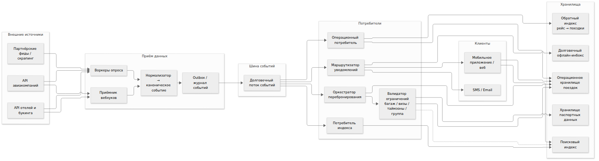
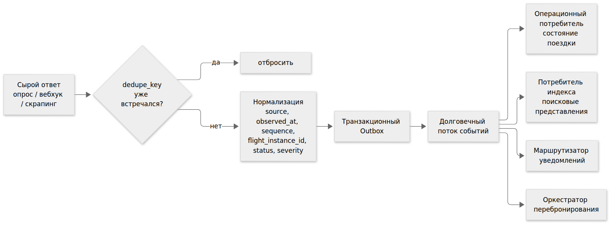
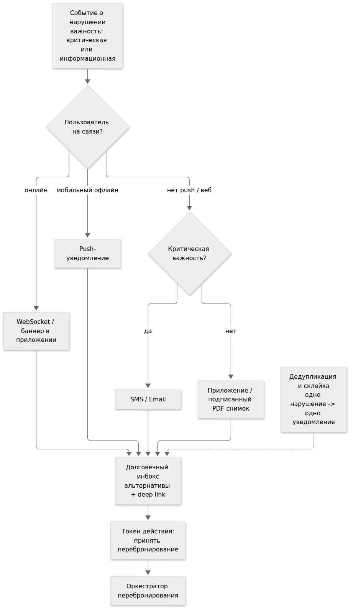
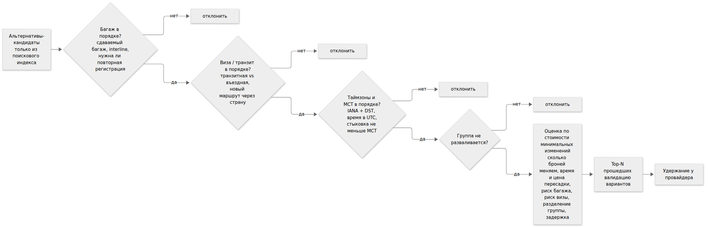
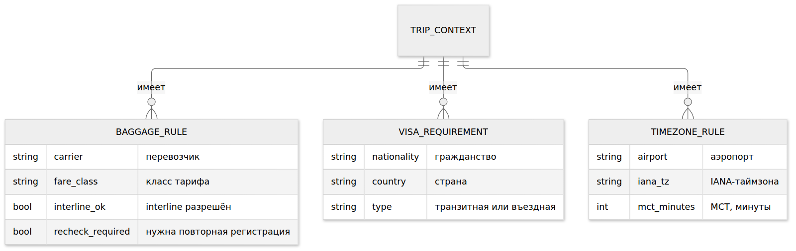
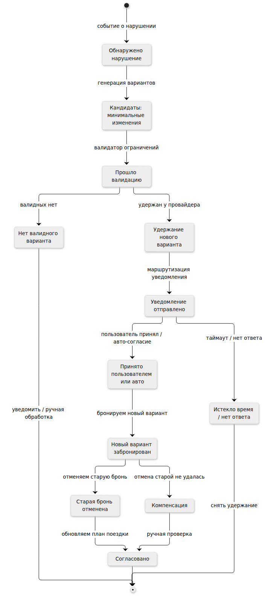
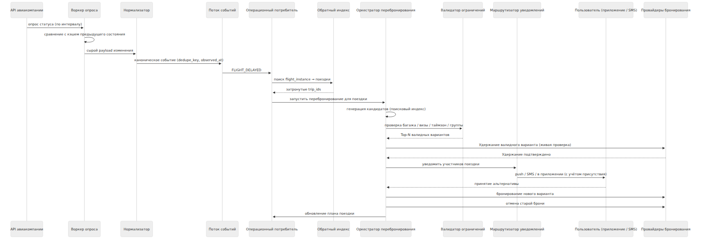
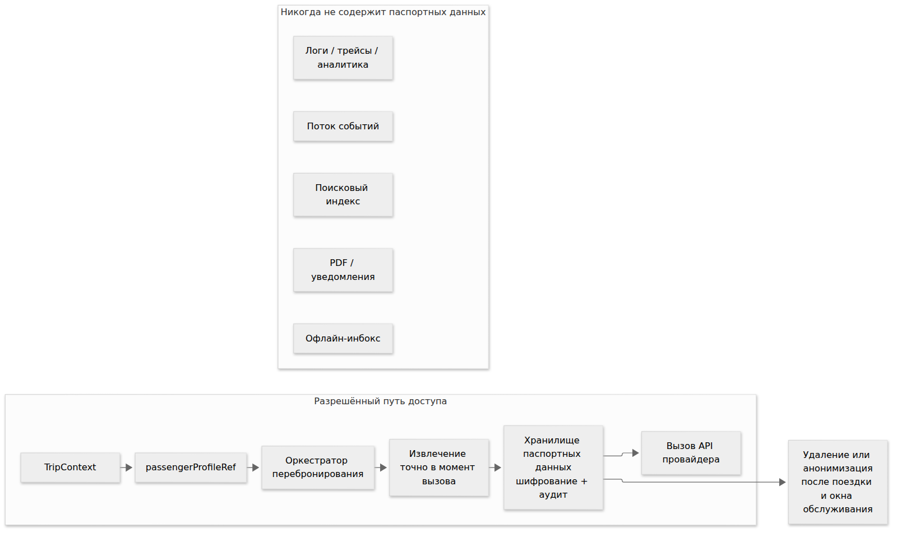

# TravelTech: обработка нарушений в плане поездки

Решение кейса "Альфред, друг Бэтмена": сервис отслеживает статус рейсов пользователя, уведомляет о задержке или отмене, предлагает альтернативы с учётом багажа, виз и таймзон и обновляет общий план поездки.

Документ описывает архитектуру и ключевые решения. Исходники диаграмм лежат в `docs/`, рендеры -- в `docs/png/`. Рабочие заметки вынесены в `appendix/working-notes/` и не являются основным артефактом.

## 1. Постановка

Сервис планирования путешествий агрегирует билеты, отели, трансферы и активности в едином плане. Внешние данные приходят с задержкой, статус рейса может измениться в любой момент, пользователь может быть офлайн. Требуется автоматически реагировать на нарушения и сохранять корректность общего плана.

В рамках кейса решаются четыре задачи:

1. Отслеживание статуса рейсов через внешние API.
2. Уведомление пользователя при задержке или отмене.
3. Подбор альтернативных рейсов и активностей.
4. Обновление общего плана путешествия.

Три ограничения задают форму решения:

- внешние данные поступают с задержкой и могут быть неполными;
- пользователь может быть офлайн в момент нарушения;
- альтернативы обязаны учитывать багаж, визы и таймзоны.

Отдельное требование -- не хранить паспортные данные дольше, чем это необходимо для поездки.

## 2. Архитектура

Все внешние источники проходят через один слой приёма и нормализации. Нормализатор приводит сырые ответы к каноническому событию с полями `event_id`, `dedupe_key`, `source`, `observed_at`, `source_sequence`, `flight_instance_id`, `status`, `severity`, `schema_version`. Событие записывается в транзакционный outbox и публикуется в долговечный поток.

Из потока читают четыре потребителя:

- **операционный** обновляет состояние поездки в операционном хранилище и в обратном индексе "рейс -> поездки";
- **индексный** строит поисковые представления для запросов пользователя;
- **маршрутизатор уведомлений** решает, кому и как доставить сообщение;
- **оркестратор перебронирования** запускает сагу.

Между оркестратором и провайдерами стоит валидатор ограничений. Он получает кандидатов из поискового индекса, проверяет их по багажу, визам, таймзонам и составу группы, ранжирует по стоимости минимальных изменений и возвращает Top-N вариантов. Поисковый индекс служит источником кандидатов; источником истины остаётся операционное хранилище, и любая запись у провайдера подтверждается живым вызовом.

## 3. Отслеживание статуса

Большинство внешних API не поддерживают webhook, поэтому основной канал -- опрос по интервалу. Воркер сравнивает ответ с кэшем предыдущего состояния и отправляет в нормализатор только изменения. Дедупликация выполняется по `dedupe_key`, который собирается из идентификатора рейса, даты вылета, нового статуса и метки времени источника. Повторный опрос с тем же результатом не порождает нового события.

Задержка данных компенсируется двумя полями. `observed_at` фиксирует момент, когда система увидела изменение, `source_sequence` -- порядковый номер ответа провайдера. Если приходит событие с `source_sequence` меньше уже обработанного, оно отбрасывается как устаревшее. Если разница между `observed_at` и временем события превышает порог, событие помечается флагом `stale`, и альтернативы по нему генерируются только после подтверждения живым запросом к провайдеру.

Webhook используется там, где провайдер его предоставляет; он попадает в тот же нормализатор и тот же outbox. Два канала не расходятся по семантике.

## 4. Уведомление пользователя

Маршрутизатор определяет канал по присутствию пользователя и важности события. Онлайн-пользователь получает сообщение через WebSocket или баннер в приложении. Мобильный офлайн -- push. Если push недоступен, а событие критическое, уходит SMS или письмо. Информационные события в этом случае остаются в приложении и попадают в подписанный PDF-снимок плана.

Каждое уведомление попадает в долговечный инбокс. В инбоксе хранится не только текст нарушения, но и предложенные альтернативы, а также токен действия: "принять перебронирование" или "удержать вариант". Пользователь, вернувшийся онлайн через несколько часов, видит готовое решение, а не только факт отмены.

Несколько событий по одной поездке склеиваются в одно уведомление. Одно нарушение порождает одно сообщение, даже если воркер увидел изменение несколько раз или если задержка затронула два сегмента подряд.

PDF -- подписанный снимок на момент отправки. Источником истины он не является, паспортных данных не содержит.

## 5. Альтернативы

Кандидаты приходят из поискового индекса. Прежде чем предложить вариант пользователю, валидатор проверяет его по четырём осям:

- **багаж** -- правила перевозчика, наличие interline-соглашения, необходимость повторной регистрации;
- **визы** -- различаются транзитная и въездная виза, маршрут через новую страну может потребовать визы, которой у пассажира нет;
- **таймзоны** -- все времена нормализуются в UTC, для отображения и правил хранится IANA-идентификатор, стыковка проверяется с учётом DST и минимального времени пересадки MCT;
- **группа** -- альтернатива не должна незаконно разделять участников групповой поездки.

Прошедшие проверку варианты ранжируются по стоимости минимальных изменений. В функцию входят число затронутых броней, время и цена пересадки, риск повторной регистрации багажа, риск визы, разделение группы и итоговая задержка. Пользователю показывается Top-N, а не один вариант.

Правила, по которым работает валидатор, вынесены в отдельную модель.

## 6. Обновление плана

Перебронирование оформлено как сага. Порядок шагов важен: новый вариант сначала удерживается у провайдера, затем пользователь получает уведомление, и только после подтверждения бронируется новый вариант и отменяется старая бронь. Отмена раньше бронирования создаёт окно, в котором у пользователя нет ни старого, ни нового билета.

Если отмена старой брони не удалась, сага переходит в состояние компенсации: возврат средств и ручная проверка. Все переходы идемпотентны, повторный запуск саги по тому же событию не создаёт вторую бронь.

План поездки обновляется на стороне операционного хранилища. Обратный индекс "рейс -> поездки" позволяет быстро найти затронутые планы и разослать обновления только им.

## 7. Сквозной сценарий

Воркер опрашивает API авиакомпании. Провайдер возвращает изменение статуса. Нормализатор публикует каноническое событие. Операционный потребитель находит затронутые поездки через обратный индекс. Оркестратор генерирует кандидатов, валидатор отбирает Top-N, оркестратор удерживает лучший вариант у провайдера. Маршрутизатор отправляет уведомление с токеном действия. Пользователь принимает альтернативу. Оркестратор бронирует новый вариант, отменяет старый и обновляет план поездки.

## 8. Паспортные данные

`TripContext` хранит только `passengerProfileRef`. Паспортные данные лежат в отдельном хранилище с шифрованием и аудитом доступа и извлекаются точно в момент вызова API провайдера. После завершения поездки и окна обслуживания данные удаляются или анонимизируются.

Паспортные данные не попадают в поток событий, поисковый индекс, логи, трейсы, аналитику, PDF, уведомления и офлайн-инбокс. Это ограничение задано на уровне архитектуры, а не политики.

## 9. Отказы и идемпотентность

| Отказ | Защита |
|---|---|
| Устаревший ответ API | `source_sequence`, флаг `stale`, подтверждение живым вызовом |
| Дублирование события | `dedupe_key`, идемпотентные потребители |
| Недоступность провайдера | circuit breaker, retry с backoff, очередь |
| Частичное перебронирование | сага с компенсацией, ручная проверка |
| Ошибка отмены старой брони | состояние `Compensating`, возврат средств |
| Разделение группы | правило группы в валидаторе, запрет незаконного разделения |
| Потеря обратного индекса | перестроение из операционного хранилища |

## 10. Компромиссы

**Опрос или webhook.** Опрос универсален, но добавляет задержку до интервала. Webhook точнее, но доступен не у всех провайдеров. Оба канала сведены к одному нормализатору, поэтому в коде не появляется двух разных путей обработки.

**Один поток или два.** Раздельные операционный и индексный потоки ускоряют доставку, но расходятся по состоянию. Выбран один канонический поток с несколькими потребителями; индекс остаётся производным представлением.

**Отмена до бронирования или после.** Отмена раньше бронирования проще, но оставляет пользователя без билета при отказе провайдера. Выбран порядок с удержанием нового варианта, ценой стала дополнительная интеграция с провайдерами, поддерживающими hold.

**Индекс как источник истины или как источник кандидатов.** Индекс быстрый и удобный, но отстаёт от реального состояния. Он используется только для генерации кандидатов; подтверждение записи идёт живым вызовом.

## 11. Журнал решений

Ключевые решения зафиксированы в `docs/adr/`:

- `0001-polling-vs-webhooks.md` -- почему опрос остаётся основным каналом;
- `0002-one-canonical-event-stream.md` -- почему один поток, а не два;
- `0003-hold-before-cancel.md` -- порядок шагов саги;
- `0004-passport-vault.md` -- граница паспортных данных.

## 12. Приложение

Скан рукописных заметок лежит в `appendix/working-notes/`. Заметки оставлены для провенанса, основным артефактом не являются. Реальных паспортных и персональных данных в репозитории нет.
